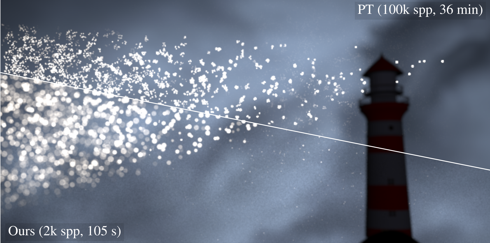
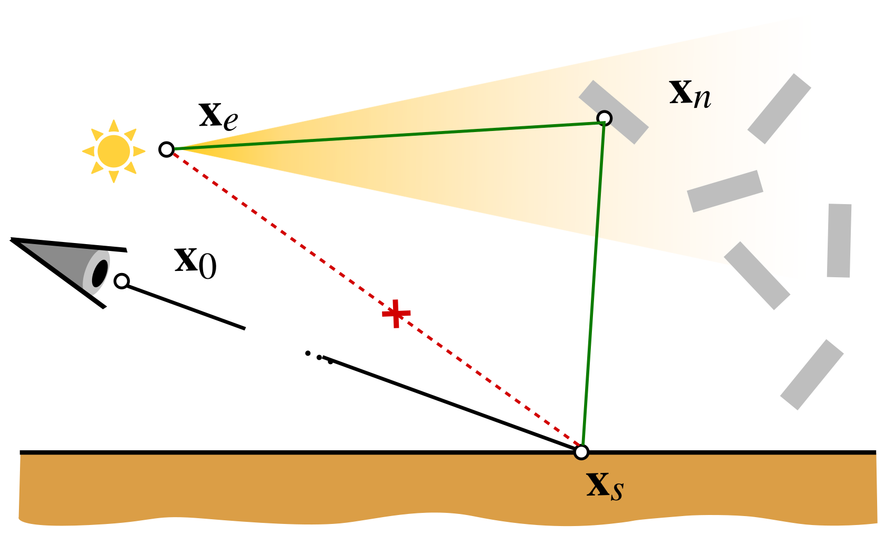
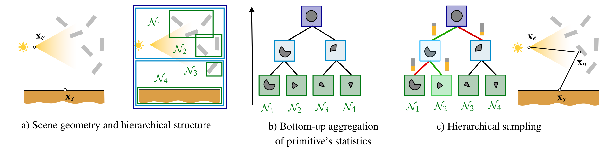
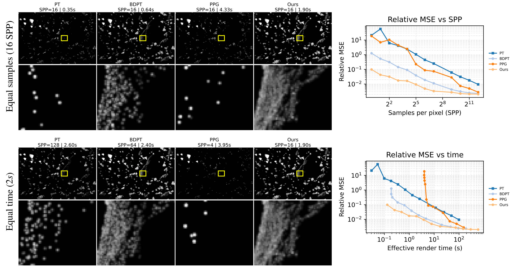

<p align="center">
  <h1 align="center"><a href="https://graphics.unizar.es/projects/OneMoreVertex26/">One-more-vertex Next-Event Estimation with Hierarchical Geometry Sampling</a></h1>
  
  <p align="center">
    Eurographics Symposium on Rendering (EGSR) 2026 - Computer Graphics Forum
    <br />
    <a href="https://jgarciapueyo.github.io/"><strong>Jorge Garcia-Pueyo*<sup>1</sup></strong></a>
    ·
    <a href="https://nestor98.github.io/"><strong>Nestor Monzon*<sup>1</sup></strong></a>
    ·
    <a href="https://orcid.org/0000-0001-9000-0466"><strong>Adrián Jarabo<sup>2</sup></strong></a>
    ·
    <a href="http://adolfo-munoz.com/"><strong>Adolfo Muñoz<sup>1</sup></strong></a>
    <br />
    *Equal Contribution
    &nbsp;&nbsp;
    <sup>1</sup>
      Universidad de Zaragoza, I3A, Spain
    &nbsp;&nbsp;
    <sup>2</sup>Independent Researcher, Spain
  </p>

  <p align="center">
    <a href='https://graphics.unizar.es/projects/OneMoreVertex26/'>
      
    </a>
    <a href='https://graphics.unizar.es/projects/OneMoreVertex26/static/omv_nee_paper_26.pdf' style='padding-left: 0.5rem;'>
      
    </a>
    <a href='https://github.com/jgarciapueyo/OneMoreVertexNEEHierarchicalGeometrySampling' style='padding-left: 0.5rem;'>
      
    </a>
  </p>
</p>

---

### Overview

Robust next-event estimation (NEE) remains a challenge in scenes characterized by **sparse or small-scale geometry** where indirect illumination is the primary transport mechanism. In these scenes, traditional path construction, which relies on local directional sampling, often fails to find intersections with the sparse geometry, and standard NEE also struggles as it typically connects vertices directly to emitters, failing when those connections are occluded or require intermediate bounces.

We propose a novel approach that constructs paths via **direct geometry sampling**. Instead of relying on stochastic ray casting, we repurpose the scene's bounding volume hierarchy (BVH) as a **hierarchical sampling structure**. By performing a stochastic top-down traversal, we transform the selection of the next path vertex into a hierarchical problem. To prioritize high-throughput connections, the traversal is guided by a **proxy contribution function** evaluated at each internal node, which leverages aggregated statistics of the geometry to efficiently estimate contribution during traversal. We demonstrate orders of magnitude improvements in complex scenarios such as indirect illumination from sparse geometry or rendering discrete scattering media.

---

### Method
<p align="center">
  
</p>

Standard next-event estimation connects sensor vertex $\mathbf{x}_s$ directly to an emitter vertex $\mathbf{x}_e$. In scenes where $\mathbf{x}_s$ is mostly illuminated through an indirect light from the scene geometry $\mathcal{G}$, that direct connection has low to zero contribution (red dashed line). Our technique tackles this by importance-sampling an intermediate vertex $\mathbf{x}_n$ on the scene geometry $\mathcal{G}$. This allows us to efficiently sample high-throughput indirect paths (green) where the geometry acts as the primary source of reflected illumination for $\mathbf{x}_s$. Note that our approach also accounts for the case when $\mathbf{x}_s$ is on the sensor $\mathbf{x}_s$ = $\mathbf{x}_0$.

Formally, we estimate the following integral over the scene geometry:

$$L(\mathbf{x}_s \leftrightarrow \mathbf{x}_e) = \int_\mathcal{G} f(\mathbf{x}_s \leftrightarrow \mathbf{x}_n \leftrightarrow \mathbf{x}_e)\, dA(\mathbf{x}_n)$$

where $f(\mathbf{x}_s \leftrightarrow \mathbf{x}_n \leftrightarrow \mathbf{x}_e)$ encodes the BSDF, geometry, visibility, and radiance terms along the three-vertex subpath.

To importance-sample $\mathbf{x}_n$ efficiently, we build a hierarchical structure over the scene primitives that aggregates directional, spatial, and material statistics at each BVH node. At render time, a stochastic top-down traversal selects a child node $\mathcal{N}_j^{d+1}$ from its parent $\mathcal{N}_i^d$ proportionally to an approximated importance weight:

$$p\left(\mathcal{N}_j^{d+1} \mid \mathcal{N}_i^d\right) = \frac{w\left(\mathcal{N}_j^{d+1}, \mathbf{x}_s, \mathbf{x}_e\right)}{w\left(\mathcal{N}_i^d, \mathbf{x}_s,\, \mathbf{x}_e\right)}$$

<p align="center">
  
</p>

> **Hierarchical One-more-vertex Sampling Overview**. (a) We wish to importance-sample high-throughput three-vertex subpaths between vertices $\mathbf{x}_s$, $\mathbf{x}_e$. Our method is based on a hierarchical structure of the scene primitives that (b) aggregates its directional, spatial, and material statistics (represented by the gray sectors) at each node bottom-up. (c) These statistics enable guiding the hierarchical sampling of the intermediate vertex $\mathbf{x}_n$ by evaluating the approximated per-node importance weight (yellow bars) for each node's children and choosing one proportionally to its weight.

---

### Results

<p align="center">
  
</p>

Comparison against path tracing (PT), bidirectional path tracing (BDPT), and practical path guiding (PPG) on the Asteroids scene. At equal samples (16 SPP) our method produces visibly cleaner results at a fraction of the time. At equal time (2 s) the gap is even more pronounced, with our method achieving orders-of-magnitude lower MSE on both the SPP and time convergence curves.

---

### Quickstart

*Requirements*: [Docker](https://docs.docker.com/get-docker/) with Docker Compose to build and run the renderer. Running the experiment pipeline (step 2) additionally needs Python 3 on the host with the packages in [`scripts/experiments/requirements.txt`](scripts/experiments/requirements.txt).

#### 1. Docker build and compilation

Clone the repository and build the image and start the container:

```bash
git clone https://github.com/jgarciapueyo/OneMoreVertexNEEHierarchicalGeometrySampling.git
cd OneMoreVertexNEEHierarchicalGeometrySampling
docker compose build
docker compose up -d
```

Enter the container:

```bash
docker exec -it onemorevertexneehierarchicalgeometrysampling-mitsuba-1 bash
```

> Docker Compose derives the container name from the folder name. If you cloned into a folder with a different name, adjust the container name here and in the `docker.container` field of the experiment YAMLs (or set the `CONTAINER` environment variable when calling `comparison.sh`).

Inside the container, compile Mitsuba:

```bash
cp build/config-linux-gcc.py config.py
python2.7 $(which scons)
source setpath.sh
```

<details>
<summary>Building the PPG baseline (optional, needed for paper comparisons)</summary>

The practical path guiding (PPG) baseline requires a separate Mitsuba build inside the container:

```bash
ln -s /home/mitsuba/data /home/mitsuba/ppg/mitsuba/data
cd ppg/mitsuba
cp build/config-linux-gcc.py config.py
python2.7 $(which scons)
```

</details>

Quick sanity check (inside the container): render the *AsteroidsCloseLight* scene with our method at 16 spp:

```bash
mitsuba scenes/22_wildcard_asteroids_smallerspotlight/wildcard_spotlight.xml -Dspp=16 -o asteroids_ours.exr
```

#### 2. Reproduce paper results

Keep the container running (`docker compose up -d`) and, from **outside** the container (repository root, on the host), install the Python dependencies and run the comparison pipeline for an experiment config:

```bash
pip install -r scripts/experiments/requirements.txt
bash scripts/experiments/comparison.sh scripts/experiments/ablation_asteroids4_smallerspotlight_ppg.yaml
```

This renders all technique variants inside the container, computes metrics (relative MSE, FLIP, …) and produces comparison figures and LaTeX assets under the `output_root` specified in the YAML. Configs that include the `ppg` baseline require building it first (see above). See [`scripts/experiments/README.md`](scripts/experiments/README.md) for the pipeline documentation and config format.

The paper configs render a high-sample-count reference (16k spp) and sweep up to 2048 spp with 3 repetitions per technique, so a full run takes several hours. For a quick test, reduce `reference.spp`, `reference_spp` and `spp_schedule` in a copy of the YAML.

<details>
<summary>Which config reproduces which figure</summary>

| Paper figure | Config / scripts |
|---|---|
| Fig. 5 (ablation), *AsteroidsFarLight* row | `scripts/experiments/ablationv2_asteroids.yaml` |
| Fig. 5 (ablation), *AsteroidsCloseLight* row | `scripts/experiments/ablation_asteroids6_smallerspotlight_trueablation.yaml` |
| Fig. 5 (ablation), *Veach* row | `scripts/experiments/ablation2_veach.yaml` (needs `quads-k5.xml`, see note below) |
| Fig. 6 (specular component) | `scripts/experiments/ablation_disney_spec.yaml` |
| Fig. 7 top (BVH depth) | `scripts/experiments/ablation_asteroids3.yaml` |
| Fig. 7 bottom (solid-angle threshold) | `scripts/experiments/ablation_asteroids3_gaussianSA.yaml` |
| Fig. 8 (sparsity analysis) | `scenes/9_rebuttal_sphere/` (`create_icospheres_densities.py`, `run_hemispheres.py`, `analyze_hemisphere_runs.py`) |
| Fig. 9 (*AsteroidsFarLight*: PT, BDPT, PPG, ours) | `scripts/experiments/ablation_asteroids3_ppg.yaml` |
| Fig. 10 (*AsteroidsCloseLight*: PT, BDPT, PPG, ours) | `scripts/experiments/ablation_asteroids4_smallerspotlight_ppg.yaml` |
| Fig. 12 (Cornell box) | `scripts/experiments/config-v11-cbox-n100.yaml` |
| Figs. 1 and 11 (*Lighthouse*) | `scenes/7_glints_lighthouse/` (integrator `oneehgsptracermis`). **Not reproducible from this repository**: the snowflake particle system (`50ksnowflakes.0001.xml`) and two meshes (`scene_geometries/Plane.003.obj`, `scenes/scene_geometries/quad_2tri2.obj`) are not included. |

Notes:
- `scenes/scene_geometries/quads-k5.xml` (Veach scene default geometry) is not committed. It can be regenerated with `python scenes/scene_geometries/create_geometry.py -n=30000 -f=scenes/scene_geometries/quad_2tri.obj -d -1 0 0 -k 5 -a 0 -10 1 -b 10 10 3 -o scenes/scene_geometries/quads-k5.xml` (same command as `quads-k40.xml` with `-k 5`; random placement, so it will not be bit-identical to the paper's).
- The hemisphere meshes for Fig. 8 are generated by `python scenes/9_rebuttal_sphere/create_icospheres_densities.py -o scenes/9_rebuttal_sphere/hemispheres_log`, which writes the `.obj` files next to the `.xml` files already in that folder.

</details>

#### 3. Create your own scene and run it

Inside the container (after compiling and sourcing `setpath.sh`), render any scene XML directly:

```bash
mitsuba path/to/scene.xml
```

To use our method in your own Mitsuba scene, add the integrator and the sampling BVH to your scene XML:

```xml
<integrator type="oneehgspath_2step">
    <integer name="maxDepth" value="3"/>
</integrator>

<geometrybvh type="samplingbvh">
    <integer name="maxDepth" value="16"/>          <!-- maximum BVH depth (Sec. 6.4) -->
    <string name="samplingMode" value="Primitive"/>
</geometrybvh>
```

The scenes in `scenes/` (e.g. `scenes/22_wildcard_asteroids_smallerspotlight/wildcard_spotlight.xml`) show all available parameters, exposed as `$name:default` wildcards that can be overridden with `-Dname=value` on the command line.

---

### Code structure

This repository is based on [Mitsuba 0.6](https://github.com/mitsuba-renderer/mitsuba). All source code outside the paths listed below is unmodified Mitsuba 0.6.

#### HGS core

| Group | Description | Path |
|-------|-------------|------|
| Headers | `SamplingBVH` class declaration; `VMFLUT` (VMF intensity via degree-4 unrolled polynomial); spherical AABB | `include/mitsuba/render/hgs/` |
| Implementation | BVH construction, per-node statistics fitting, importance weight computation, stochastic traversal sampling | `src/librender/hgs/` |
| Plugin | Mitsuba plugin registration wrapper for `SamplingBVH` | `src/hgs/` |

#### Integrators

| Plugin name | Description | Path |
|-------------|-------------|------|
| `oneehgspath_2step` | One-more-vertex path tracer with MIS between our BVH-sampled vertex and BSDF sampling (Sec. 5). **This is the integrator used for "ours" in the paper's path-tracing results.** | `src/integrators/oneehgspath/oneehgspath_2step.cpp` |
| `oneehgspath_2step_fast` | Experimental faster variant of the above (probabilistic second-vertex sampling) | `src/integrators/oneehgspath/oneehgspath_2step_fast.cpp` |
| `oneehgspath` | Earlier one-more-vertex path tracer without the BSDF-sampling MIS strategy | `src/integrators/oneehgspath/oneehgspath.cpp` |
| `oneehgsptracer` | One-more-vertex particle tracer (sensor vertex $\mathbf{x}_s = \mathbf{x}_0$) | `src/integrators/oneehgsptracer/` |
| `oneehgsptracermis` | One-more-vertex particle tracer with MIS (used for the *Lighthouse* scene) | `src/integrators/oneehgsptracermis/` |

The sampling BVH is only built when one of these integrators is used.

#### Scenes, scripts, and infrastructure

| Component | Description | Path |
|-----------|-------------|------|
| Scenes | Mitsuba XML scene files for all paper experiments (Asteroids, Disney, Veach, Cornell box, Glints, …) | `scenes/` |
| Experiment pipeline | Shell and Python scripts to render all technique variants, compute MSE/FLIP metrics, and produce comparison figures and LaTeX assets | `scripts/experiments/` |
| LUT tools | Python scripts to generate the VMF intensity LUT and fit the degree-4 polynomial approximation | `scripts/LUT/` |
| PPG baseline | Practical path guiding as a self-contained Mitsuba build used for paper comparisons | `ppg/` |
| Docker | Containerized build and run environment | `Dockerfile`, `docker-compose.yml` |
| Legacy | Earlier scenes and experiment configs kept for reference only; they still use the old plugin names (`doublestep`, `glinttracer`, `geometrybvh`, …) and paths (`scenes/experiments/…`) and are not maintained | `old_scenes/`, `old_scripts/` |

---

### Citation

```bibtex
@article{onemorevertex26,
  journal = {Computer Graphics Forum},
  title = {{One-more-vertex Next-Event Estimation with Hierarchical Geometry Sampling}},
  author = {Garcia-Pueyo, Jorge and Monzon, Nestor and Jarabo, Adrian and Muñoz, Adolfo},
  year = {2026},
  publisher = {The Eurographics Association and John Wiley & Sons Ltd.},
  ISSN = {1467-8659},
  DOI = {10.1111/cgf.70539}
}
```
